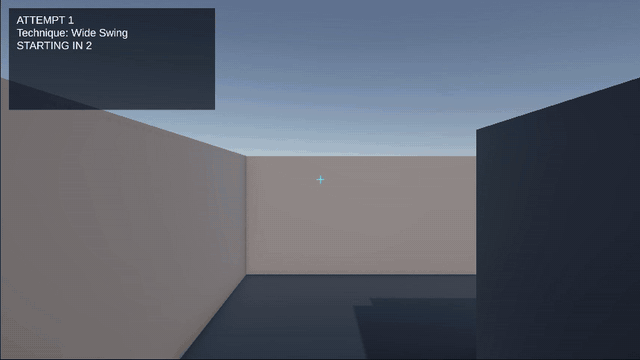

# PeekLab

PeekLab is a Unity prototype for practicing and inspecting movement around cover in a first-person environment. Record a peek, replay it from an opponent's viewpoint, and compare how quickly the movement becomes visible with how stable the first shot was.

## Demo

**[Watch Demo 1 — Corner Peek Prototype](Demos/Demo-01_2026-10-13/PeekLab-Demo-01.mp4)** · Recorded October 13, 2026

The animated preview plays directly above. Open the full MP4 for the complete recording, or browse the [demo archive](Demos/) to follow the prototype's progress.

## Current prototype

- First-person movement with collision and mouse look
- Camera-based raycast shooting and reaction-time targets
- Movement and shot recording
- Smooth movement replay through a visible ghost
- Switchable player and opponent viewpoints
- Multi-point visibility detection for the ghost's head and shoulders
- First-visibility and exposure-to-shot timing
- Shot stability, movement speed, and stop-before-shot measurement
- Repeatable countdown, recording, review, replay, and results states
- Attempt history with best-result comparison
- Peek labels for wide swings, slow peeks, jiggle peeks, and custom attempts
- In-game status and results display

## Controls

- **WASD:** Move
- **Mouse:** Look
- **Left click:** Shoot
- **1-4:** Select the peek label
- **R:** Start or stop an attempt
- **P:** Replay the latest recording
- **V:** Switch between player and opponent viewpoints
- **Escape:** Release the cursor

## Run the prototype

1. Install Unity **6000.6.4f1** through Unity Hub.
2. Clone this repository and add its root folder as a Unity project.
3. Open `Assets/Scenes/SampleScene.unity`.
4. Press Play, select a peek label with **1-4**, and press **R** to begin an attempt.

The training flow is **countdown → record → review → replay → results**. After recording, use **V** to inspect the opponent view and **P** to replay the recorded movement. Press **R** from the results screen to start another attempt.

## How the feedback works

- **First visible** is the replay time when one of the ghost's sampled head or shoulder points is inside the opponent camera and is not blocked by an obstacle.
- **Exposure before shot** is the time between first visibility and the first recorded shot at or after that moment.
- **Stable shot** reports whether the player was stationary when that shot was recorded. The result also includes movement speed and how long the player had been stopped.
- **Best exposure** is the lowest valid exposure time from the current play session.

These values are prototype feedback sampled during Unity frame updates. They are useful for comparing attempts in the same scenario, but they are not a validated measurement of VALORANT movement, networking, or real-world player improvement.

## Verification status and limitations

- The current demo shows the complete record, review, replay, and results flow running in the Unity Editor.
- Seven Unity EditMode tests verify exposure timing, eligible-shot selection, no-result cases, and the selected shot's movement data.
- Camera visibility, obstacle handling, and the complete scene flow still require manual verification. The repository does not yet contain a CI workflow.
- Visibility uses four sample points on a capsule rather than an animated character model.
- Attempt history lasts only for the current play session.
- Peek selections label attempts for comparison; they do not yet change movement behavior.
- The project currently contains one prototype corner scenario and uses Unity primitive geometry.

## Automated tests

Open **Window → General → Test Runner**, select **EditMode**, and run all tests. The current suite covers the pure exposure calculation separately from Unity's frame updates:

- Select the earliest shot at or after first visibility
- Ignore shots recorded before visibility
- Treat a shot at the exact visibility time as zero exposure
- Return no result when no eligible shot exists
- Keep missing visibility distinct from visibility at time zero
- Return movement and stability data from the selected shot

## Development updates

| Milestone | What changed | Commit |
| --- | --- | --- |
| First-person foundation | Added movement, collision, mouse pitch, and player yaw. | [`386fc99`](https://github.com/YolunaFruit/PeekLab/commit/386fc99) |
| Target and replay prototype | Added timed targets, reaction measurement, recording, and smooth ghost replay. | [`77fa58f`](https://github.com/YolunaFruit/PeekLab/commit/77fa58f) |
| Opponent-view analysis | Added viewpoint switching, multi-point visibility checks, and exposure timing. | [`18bb25b`](https://github.com/YolunaFruit/PeekLab/commit/18bb25b) |
| Repeatable training sessions | Added session states, countdowns, input locking, results, and attempt comparisons. | [`88094ce`](https://github.com/YolunaFruit/PeekLab/commit/88094ce) |
| Shot stability analysis | Added movement speed and stop-before-shot measurements. | [`8861f97`](https://github.com/YolunaFruit/PeekLab/commit/8861f97) |
| Technique comparison | Added selectable peek labels and saved each technique with its result. | [`7a58830`](https://github.com/YolunaFruit/PeekLab/commit/7a58830) |
| Playable corner scenario | Added an L-shaped practice route, clearer HUD, crosshair, target styling, and replay-ghost styling. | [fcbb971](https://github.com/YolunaFruit/PeekLab/commit/fcbb971) |
| Verified exposure calculation | Separated exposure selection from Unity's frame loop and added seven passing EditMode tests. | [`b974f48`](https://github.com/YolunaFruit/PeekLab/commit/b974f48) |

## Project status

The core training loop and first corner scenario work end to end. Exposure selection is now covered by automated EditMode tests. The next quality milestone is to verify the affected scene flow manually and then run the test suite through continuous integration. Slow-walk, crouch movement, and environment polish can follow after the core measurement workflow is verified.

## Built with

- Unity 6.6 (6000.6.4f1)
- C#
- Unity Input System
- TextMesh Pro

## Asset note

The current prototype uses Unity primitive geometry and contains no third-party game assets.
